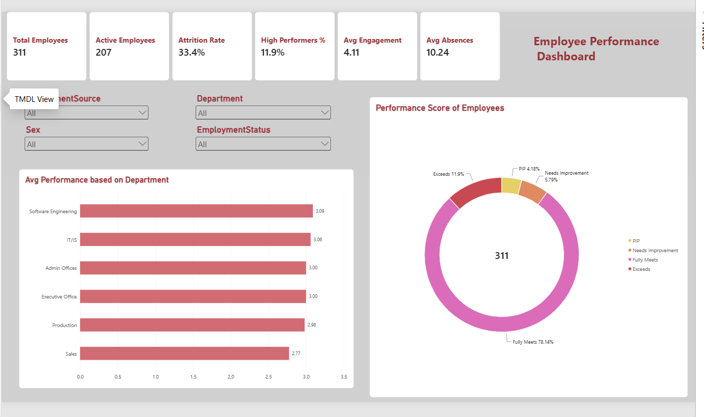
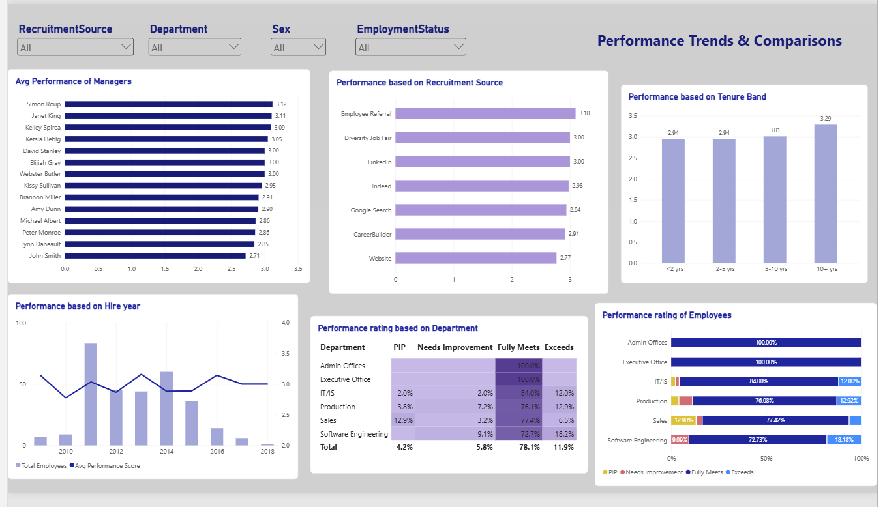
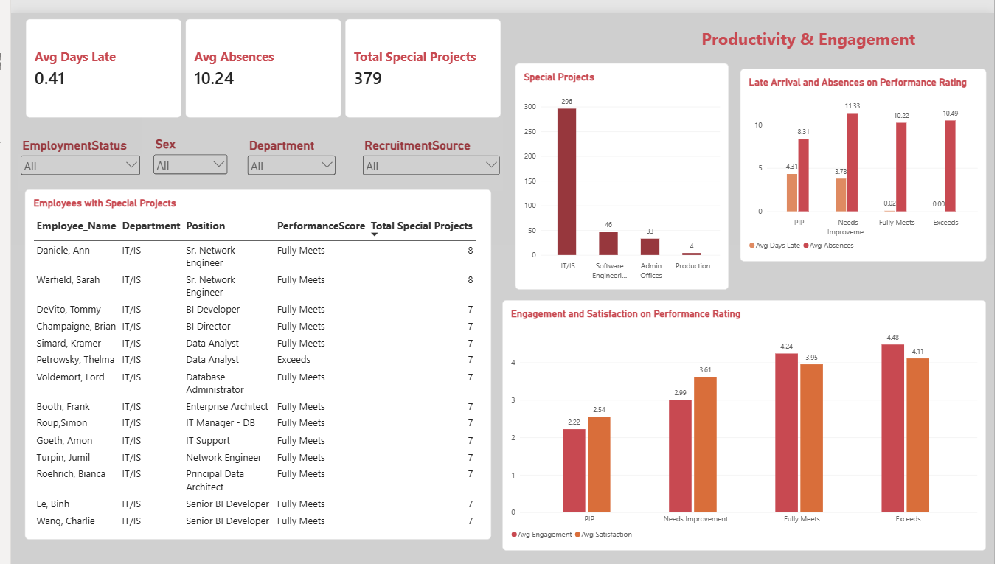
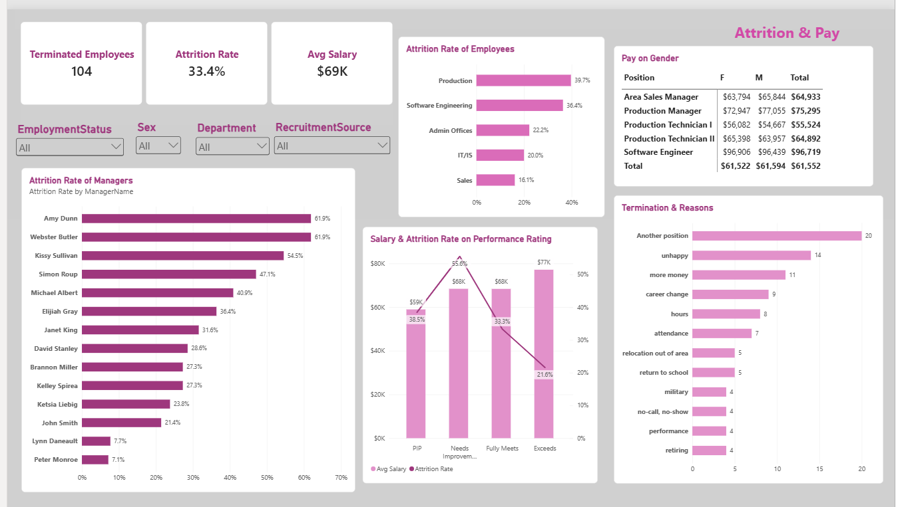

# Employee Performance Dashboard (Power BI)

An interactive Power BI dashboard that tracks employee performance, productivity, engagement, attrition and pay for a 311-employee company. It uses the public Kaggle HR Analytics dataset and covers the full workflow: data cleaning in Power Query, a small data model, DAX measures, and a four-page report with a drill-through employee view.

## Business Problem

HR and department leaders need a single place to answer questions like:

- How are employees performing overall, and which departments, managers and hiring channels stand out?
- Do engagement, punctuality and absences line up with performance ratings?
- Where is attrition highest, and why do people leave?
- Is pay consistent across performance ratings and between women and men in the same role?

## Dataset

- **Source:** [Human Resources Data Set on Kaggle](https://www.kaggle.com/rhuebner/human-resources-data-set) (`HRDataset_v14.csv`). Check the Kaggle page for the licence and terms before reusing the data.
- **Size:** 311 employees, 36 columns.
- **Time frame:** a point-in-time snapshot. The latest performance review date is 28 Feb 2019, which I use as the "as of" date for tenure and age.
- **Key fields:** `PerformanceScore` / `PerfScoreID`, `EngagementSurvey`, `EmpSatisfaction`, `SpecialProjectsCount`, `DaysLateLast30`, `Absences`, `Department`, `Position`, `ManagerName`, `RecruitmentSource`, `Salary`, `Sex`, `Termd`, `TermReason`, `DateofHire`, `DateofTermination`.

## Tools

Power BI Desktop, Power Query (M), DAX.

## Data Preparation (Power Query)

| Step | What I did and why |
|---|---|
| Trim and clean text | Removed leading and trailing spaces in `Department`, `Position`, `ManagerName`, `Employee_Name`, `Sex`, `RecruitmentSource` and `PerformanceScore`. Without this, "Production" and "Production " appeared as two departments. |
| Fix date parsing | Dates are stored as month/day/year. My regional settings read them day-first, which produced errors on dates such as `1/17/2019` and silently swapped others. I re-converted the four date columns using the **English (United States)** locale. |
| Set data types | Whole numbers for IDs, counts and salary; decimal for the engagement score; dates for the four date columns. |
| Add columns | `Tenure End` (termination date, or the 28 Feb 2019 snapshot date for active staff), `Tenure Years`, `Hire Year`, `Tenure Band` (<2, 2-5, 5-10, 10+ yrs) with a `Tenure Band Order` sort column, `Age`, `Salary Band`. |
| Fix inconsistent scores | Two records had a `PerfScoreID` that contradicted their `PerformanceScore` label (one "Fully Meets" with ID 1, one "PIP" with ID 3). I rebuilt `PerfScoreID` from the label (PIP = 1, Needs Improvement = 2, Fully Meets = 3, Exceeds = 4) so each label maps to one ID. |
| Remove unused columns | Dropped `Zip`, `MarriedID`, `GenderID`, `MaritalStatusID`, `EmpStatusID`, `DeptID`, `PositionID`, `FromDiversityJobFairID` and the helper `Tenure End` column. |

## Data Model

A single fact table (`HR`) plus two helper tables:

- `Date` table (`CALENDAR`), related one-to-many to `HR[DateofHire]`.
- `Performance Rating` lookup table (PIP, Needs Improvement, Fully Meets, Exceeds), related one-to-many to `HR[PerformanceScore]`, with `Rating Order` used to sort ratings logically instead of alphabetically.

```DAX
Date =
ADDCOLUMNS(
    CALENDAR(
        DATE(YEAR(MIN(HR[DateofHire])), 1, 1),
        DATE(YEAR(MAX(HR[LastPerformanceReview_Date])), 12, 31)
    ),
    "Year", YEAR([Date]),
    "Month No", MONTH([Date]),
    "Month", FORMAT([Date], "MMM")
)

Performance Rating =
DATATABLE(
    "PerformanceScore", STRING,
    "Rating Order", INTEGER,
    {
        {"PIP", 1},
        {"Needs Improvement", 2},
        {"Fully Meets", 3},
        {"Exceeds", 4}
    }
)
```

## Key DAX Measures

```DAX
Total Employees = DISTINCTCOUNT(HR[EmpID])

Active Employees = CALCULATE([Total Employees], HR[EmploymentStatus] = "Active")

Terminated Employees = CALCULATE([Total Employees], HR[Termd] = 1)

Attrition Rate = DIVIDE([Terminated Employees], [Total Employees])

Avg Performance Score = AVERAGE(HR[PerfScoreID])

High Performers % =
DIVIDE(CALCULATE([Total Employees], HR[PerformanceScore] = "Exceeds"), [Total Employees])

Low Performers % =
DIVIDE(
    CALCULATE([Total Employees], HR[PerformanceScore] IN {"Needs Improvement", "PIP"}),
    [Total Employees]
)

Avg Engagement = AVERAGE(HR[EngagementSurvey])
Avg Satisfaction = AVERAGE(HR[EmpSatisfaction])
Avg Absences = AVERAGE(HR[Absences])
Avg Days Late = AVERAGE(HR[DaysLateLast30])
Total Special Projects = SUM(HR[SpecialProjectsCount])
Avg Salary = AVERAGE(HR[Salary])
Avg Tenure Years = AVERAGE(HR[Tenure Years])
```

## Dashboard Pages

All pages share four synced slicers: Recruitment Source, Department, Sex and Employment Status.

### 1. Executive Overview
KPI cards (Total Employees, Active Employees, Attrition Rate, High Performers %, Avg Engagement, Avg Absences), a performance rating donut, and average performance score by department.



### 2. Performance Trends & Comparisons
Average performance by manager, recruitment source and tenure band; a hire-year cohort chart (headcount and average score); a department x rating heatmap; and rating mix by department.



### 3. Productivity & Engagement
Days late and absences by rating, engagement and satisfaction by rating, special projects by department (departments with no special projects are hidden), and a top special-projects table with drill-through to an employee detail page.



### 4. Attrition & Pay
Attrition by department and manager, top termination reasons, average salary and attrition by rating, and average pay by position and sex.



### Employee Detail (drill-through)
Right-click an employee in the special-projects table and choose **Drill through** to see that person's department, position, manager, rating, salary, tenure, engagement, satisfaction, projects, absences and days late.

## Key Insights

- **Overall:** 311 employees, 207 active, 104 terminated (33.4% attrition). The rating mix is 78.1% Fully Meets, 11.9% Exceeds, 5.8% Needs Improvement and 4.2% PIP.
- **Departments:** Sales has the lowest average performance score (2.77) and the highest PIP share (12.9%, 4 of 31 employees). Production has the highest attrition at 39.7% (83 of 209).
- **Hiring channels:** Employee Referral hires have the highest average score (3.10) and Website hires the lowest (2.77, only 13 employees).
- **Managers:** among managers with 10 or more employees, average scores range from 2.71 to 3.12 and attrition ranges from about 7% to 62%.
- **Punctuality vs. rating:** employees rated PIP are late 4.3 days on average and Needs Improvement 3.8, versus about 0 for Fully Meets and Exceeds. Absences show no clear pattern across ratings (roughly 8 to 11 days).
- **Engagement vs. rating:** engagement rises with rating, from about 2.2 for PIP to about 4.5 for Exceeds.
- **Special projects:** IT/IS accounts for 296 of the 379 special projects.
- **Exit reasons:** the top reasons are another position (20 of 104), unhappy (14) and more money (11).
- **Attrition and pay by rating:** employees rated Exceeds leave least (21.6%) and earn the most on average, while Needs Improvement has the highest attrition (55.6%, 18 employees).
- **Pay by sex:** the overall average salary is about $67.8K for women and $70.6K for men, but within the same position the gaps are small and go both ways. The overall difference mostly reflects which roles people hold.

## Limitations

- The data is a single snapshot with one performance rating per employee, so "trends" are cohort comparisons (hire year, tenure band), not a true time series.
- Many groups are small (some departments, managers, ratings and hiring channels have fewer than 20 people). I filtered some charts to groups of 10 or more, and percentages for small groups can swing widely.
- Relationships shown are associations, not causes. For example, late arrivals could be a reason for low ratings, a result of them, or both.
- Special project counts largely reflect the department someone works in, so they are not a like-for-like productivity measure across departments.
- The pay comparison is descriptive and does not control for experience, location or other factors.

## How to Use

1. Download `employee_performance.pbix`.
2. Open it in Power BI Desktop (Windows).
3. If you want to refresh the data, download `HRDataset_v14.csv` from Kaggle and point the `HR` query to its location in Power Query.

## Repository Structure

```
.
├── HR_Employee_Performance_Dashboard.pbix
├── README.md
└── screenshots/
    ├── 01-executive-overview.png
    ├── 02-performance-trends.png
    ├── 03-productivity-engagement.png
    └── 04-attrition-pay.png
```

## Skills Demonstrated

Data cleaning and profiling in Power Query, locale-aware date handling, data quality checks, data modelling (date and lookup tables), DAX measures, dashboard design and storytelling, and cautious interpretation of small-sample HR data.

## Author

Your Name | [LinkedIn](https://www.linkedin.com/in/your-profile) | your.email@example.com
